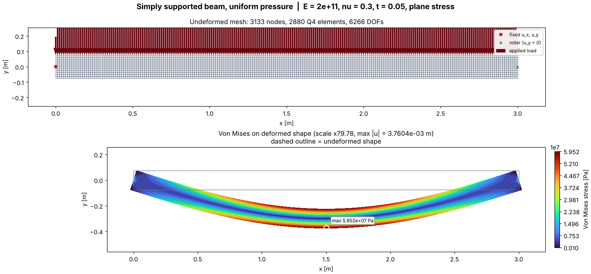
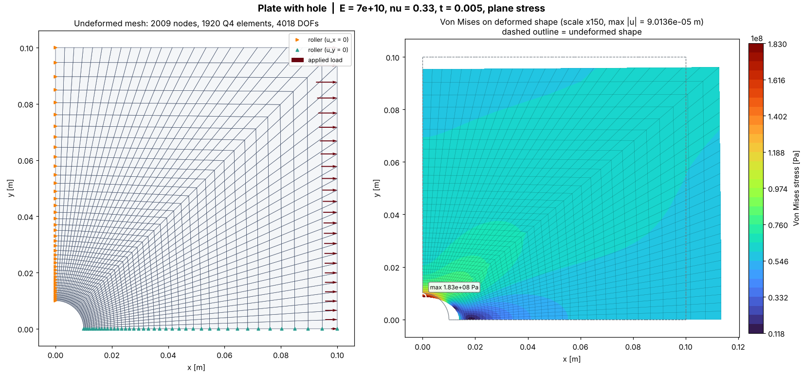
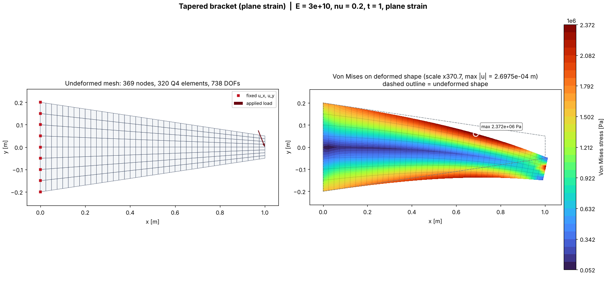

# Q4 FEA Structural Solver

**Work out how flat parts bend, stretch and how stressed they get: beams, brackets, plates, walls.** You describe the shape, the material, how it's held and how it's loaded, and you get back displacements, reaction forces, stresses, Von Mises stress, a safety factor and contour pictures.

It's a 2D finite element solver written from scratch in Python. It uses no commercial or black-box solver: every step (element maths, numerical integration, sparse assembly, solving, stress recovery) is plain, readable code in [`engine/fea_solver.py`](engine/fea_solver.py).

  


---

## Quick start

### Option A: no installation (Google Colab, in your browser)

1. Open <https://colab.research.google.com> → **File → Open notebook → GitHub**.
2. Paste `https://github.com/nothikemu/CFD`, choose branch `claude/sharp-carson-1l4xvs`, and open `examples/quickstart.ipynb`.
3. Press **▶** on each box, top to bottom. Edit the **SETTINGS** box and press **▶** again to try your own numbers.

### Option B: on your computer

```bash
git clone -b claude/sharp-carson-1l4xvs https://github.com/nothikemu/CFD.git
cd CFD
python3 -m pip install -r requirements.txt     # numpy, scipy, matplotlib, pytest
python3 -m pytest test_validation.py -q        # should say: 24 passed
python3 app.py                                 # run the benchmarks; pictures go to output/
```
Windows: type `python` instead of `python3`. To use a private environment, a ZIP download, or VS Code, see [Installation](docs/installation.md).

---

## Your first model in 12 lines

Create `my_first_model.py` **in the `CFD` folder** (next to `app.py`):

```python
from engine import Mesh, Material, FEAModel
from visualizer import plot_results

mesh  = Mesh.structured_rectangle(length=1.0, height=0.1, nx=100, ny=10)   # 1. shape (metres)
steel = Material(E=210e9, nu=0.3, thickness=0.02, yield_strength=250e6)    # 2. material (Pa)
model = FEAModel(mesh, steel)
model.fix(mesh.nodes_at(x=0.0), "xy")                                      # 3. clamp the left edge
tip = mesh.closest_node(1.0, 0.05)
model.add_nodal_force(tip, fy=-2000)                                       # 4. 2000 N down at the tip
r = model.solve()                                                          # 5. solve

print("tip drop [m]   :", r.displacements[tip, 1])
print("max stress [Pa]:", r.max_von_mises)
print("safety factor  :", r.safety_factor.min())
plot_results(model, r, filename="output/my_first_model.png")
```

```bash
python3 my_first_model.py
```
```
tip drop [m]   : -0.0019067420036835304
max stress [Pa]: 65017683.28810252
safety factor  : 3.84510778232769
```

The end drops 1.9 mm (beam theory says 1.905 mm), the peak stress is 65 MPa, and the part could take 3.8× this load before yielding. The [Tutorial](docs/tutorial.md) explains every line and what to try next.

---

## What it can do

| | |
|---|---|
| **Shapes** | Built-in rectangle and plate-with-hole meshes, or **any shape** from your own node coordinates and connectivity |
| **Elements** | 4-node isoparametric quadrilaterals (Q4), 2×2 Gauss integration |
| **Material** | Isotropic linear elastic: `E`, `nu`, thickness, optional yield strength |
| **2D assumption** | Plane stress (thin parts) or plane strain (thick/long bodies: dams, tunnels, walls) |
| **Supports** | Clamps, pins, rollers, symmetry lines, prescribed non-zero displacements |
| **Loads** | Point forces; pressure/traction along edges, constant or varying with position |
| **Solver** | Sparse direct solver; automatic switch to preconditioned conjugate gradient above 50 000 unknowns |
| **Results** | Displacements, reactions, strains, stresses (σxx, σyy, τxy, σzz), Von Mises, safety factor |
| **Safety checks** | Element orientation, distorted elements, missing supports, element matrix symmetry, global equilibrium |
| **Output** | Step-by-step maths log, contour plots on the deformed shape, CSV export |

---

## Gallery

| Beam on two supports, uniform pressure | Plate with a hole (¼ model, symmetry) |
|---|---|
|  |  |
| **Custom hand-built mesh, plane strain** | **Stress components** |
|  |  |

Each picture comes from a runnable script in [`examples/`](examples). See the [Examples guide](docs/examples.md).

---

## Documentation

| Guide | |
|---|---|
| [Installation](docs/installation.md) | Colab (no install), Windows / Mac / Linux, virtual environments, VS Code |
| [Tutorial](docs/tutorial.md) | A complete first analysis, step by step, with the expected output |
| [Examples](docs/examples.md) | Six ready-made scripts plus a notebook, with results and pictures |
| [User guide](docs/user-guide.md) | Units, meshes, choosing nodes, materials, supports, loads |
| [Results, export and plots](docs/results-and-plots.md) | Every result field, CSV/Excel export, picture options |
| [Built-in benchmarks](docs/benchmarks.md) | `app.py` command-line options and the step-by-step log |
| [Configuration and performance](docs/configuration.md) | Solver settings, logging, advanced options, speed |
| [Accuracy and validation](docs/accuracy-and-validation.md) | Mesh guidance and what the 24 tests prove |
| [Troubleshooting](docs/troubleshooting.md) | Every error message explained, with the fix |
| [API reference](docs/api-reference.md) | Every class, method, argument and result |
| [Theory and limitations](docs/theory.md) | The equations implemented, and what the solver can't do |

---

## Command cheat sheet

```bash
python3 app.py                         # benchmarks + step-by-step log + pictures
python3 app.py --nx 320 --ny 16        # finer benchmark mesh
python3 app.py --plane strain          # plane strain benchmarks
python3 app.py --scale 50              # exaggerate deformation 50x in pictures
python3 app.py --no-plot --quiet       # numbers only, warnings only
python3 app.py --run-tests             # benchmarks, then the validation suite
python3 app.py --help                  # all options

python3 -m pytest test_validation.py -v    # validation suite
python3 examples/01_my_beam.py             # any example (01 … 06)
python3 docs/make_images.py                # regenerate documentation pictures
```

---

## Validation

The headline test clamps a steel beam (L/h = 20) and loads its tip. The solver's tip deflection is compared with the Euler-Bernoulli formula δ = PL³/3EI:

| Mesh | Error vs beam theory |
|---|---|
| 80 × 4 | −2.9 % |
| 160 × 8 (default) | **−0.66 %** ✔ (limit ±2 %) |
| 320 × 16 | −0.08 % |

The other 23 tests cover patch tests on distorted meshes (exact constant stress), element properties (symmetry, 3 rigid-body modes, exact area), plane strain, equilibrium, the bad-mesh and missing-support guards, and both solver paths. See [Accuracy and validation](docs/accuracy-and-validation.md).

---

## Project layout

```
CFD/
├── engine/fea_solver.py     the solver: Mesh, Material, Q4Element, FEAModel, FEAResults
├── engine/__init__.py       public API
├── visualizer.py            Matplotlib pictures
├── app.py                   benchmark program (command line)
├── test_validation.py       24 validation tests
├── examples/                6 runnable scripts + Colab notebook
├── docs/                    full documentation + pictures
├── requirements.txt
└── output/                  your generated pictures / CSVs (not committed)
```

## Limitations (short version)

Linear elastic, small deformations, static loads, 2D (plane stress / plane strain), one isotropic material, quadrilateral elements only. The full list is in [Theory and limitations](docs/theory.md#limitations).
