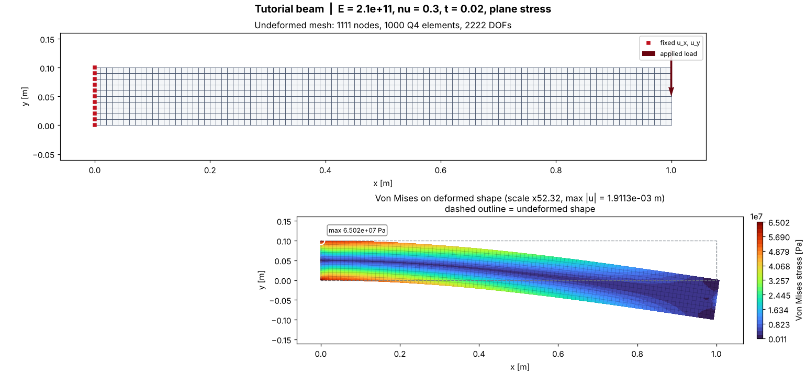
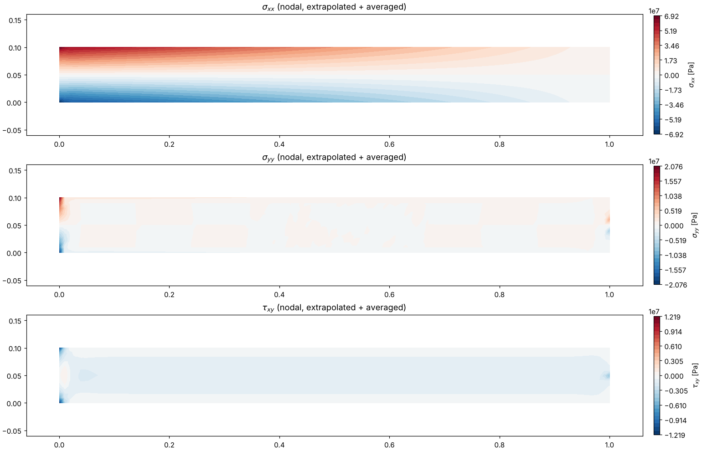

[← Documentation home](README.md) · [Main README](../README.md)

# Tutorial: your first analysis, step by step

This walks through one complete job from an empty file to a stress picture. It shows the **exact output you should see** at every step, so you can tell whether things are going right.

**The problem:** a steel bar, 1 m long, 10 cm tall and 2 cm thick, is bolted to a wall at its left end. Someone hangs 2000 N (about 200 kg) from the right end. How far does the end drop? How stressed is the steel? Will it bend permanently?

```
 wall
  ██|===============================================|
  ██|                 1.0 m  x  0.1 m                | ↓ 2000 N
  ██|===============================================|
   x = 0                                          x = 1.0
```

> **Before you start:** install the solver ([Installation](installation.md)) and check that `python3 -m pytest test_validation.py -q` says `24 passed`.
> No terminal? Every step below also works pasted into a Google Colab cell (see [Installation → Colab](installation.md#fastest-start-no-terminal-google-colab)).

---

## Step 0: make a file

In the `CFD` folder (the one containing `app.py`), create a new text file called **`my_first_model.py`**. You can use any editor: VS Code, Notepad, TextEdit (in plain-text mode) or IDLE.

Every snippet below goes into this file, **one after another**. Run the file after each step to see the new output:

```bash
python3 my_first_model.py        # Windows: python my_first_model.py
```

---

## Step 1: import the solver

```python
import numpy as np
from engine import Mesh, Material, FEAModel
from visualizer import plot_results, plot_stress_components
```

Running it prints nothing, and that's correct. If you get `ModuleNotFoundError: No module named 'engine'`, the file isn't in the `CFD` folder.

---

## Step 2: describe the shape (the mesh)

The solver splits the bar into small four-sided cells called **elements**. Their corners are called **nodes**.

```python
mesh = Mesh.structured_rectangle(length=1.0, height=0.1, nx=100, ny=10)
print(mesh)
```

Output:
```
Mesh(n_nodes=1111, n_elements=1000, n_dofs=2222)
```

- `nx=100, ny=10` means 100 elements along the bar and 10 through its height, so 1000 elements of 1 cm × 1 cm.
- That gives 101 × 11 = **1111 nodes**. Each node can move in x and y, so there are **2222 unknowns** ("DOFs") to solve for.
- The bottom-left corner is at (0, 0) and the top-right at (1.0, 0.1).

Want to look inside?
```python
print(mesh.nodes[:3])      # first three node coordinates
print(mesh.elements[0])    # the 4 node numbers of the first element
```
```
[[0.   0.  ]
 [0.01 0.  ]
 [0.02 0.  ]]
[  0   1 102 101]
```
Element 0 joins nodes 0 → 1 → 102 → 101, which goes bottom-left, bottom-right, top-right, top-left. That's **counter-clockwise**, which the solver requires.

---

## Step 3: describe the material

```python
steel = Material(E=210e9, nu=0.3, thickness=0.02, yield_strength=250e6, name="steel")
print(steel)
```
```
Material(name='steel', E=2.1e+11, nu=0.3, t=0.02, plane='stress')
```

| Value | Meaning |
|---|---|
| `E=210e9` | Stiffness of steel: 210 GPa = 210 000 000 000 Pa |
| `nu=0.3` | Poisson's ratio: how much it narrows when stretched |
| `thickness=0.02` | The bar is 2 cm thick (into the page) |
| `yield_strength=250e6` | The steel bends permanently above 250 MPa. Needed for the safety factor. |
| `plane="stress"` (default) | Right for thin, flat parts like this bar |

All values are in **metres, newtons and pascals**. Never mix units: see [Units](user-guide.md#units-pick-one-consistent-set).

---

## Step 4: create the model and hold it (supports)

```python
model = FEAModel(mesh, steel)

wall = mesh.nodes_at(x=0.0)        # every node on the line x = 0
print(wall)
model.fix(wall, "xy")              # they cannot move in x or y
```
```
[   0  101  202  303  404  505  606  707  808  909 1010]
```

Those are the 11 nodes on the left edge. `"xy"` clamps them completely, like a weld. Other options are `"x"` (holds sideways only) and `"y"` (holds up/down only). See [Supports](user-guide.md#supports-dirichlet-boundary-conditions).

---

## Step 5: push it (loads)

```python
tip = mesh.closest_node(1.0, 0.05)    # node nearest the middle of the right end
print(tip, mesh.nodes[tip])
model.add_nodal_force(tip, fy=-2000)  # 2000 N downward (negative y)
```
```
605 [1.   0.05]
```

To spread a load along an edge instead (pressure, wind, water), see [Loads](user-guide.md#loads-neumann-boundary-conditions).

---

## Step 6: solve

```python
r = model.solve()
print(r.diagnostics["solver"], f"| residual: {r.diagnostics['relative_residual']:.2e}")
```
```
SciPy sparse direct (SuperLU) | residual: 2.49e-11
```

That's it: the solver built and solved 2222 equations in a few hundredths of a second. A tiny residual means the equations were solved accurately.

> **Want to see all the maths?** Add these two lines at the top of the file to print the step-by-step log (Jacobians, matrix sizes, equilibrium checks...):
> ```python
> import logging, sys
> logging.basicConfig(level=logging.INFO, stream=sys.stdout, format="%(message)s")
> ```
> [Benchmarks → Understanding the log](benchmarks.md#understanding-the-log) explains each line.

---

## Step 7: read the answers

```python
ux, uy = r.displacements[tip]
print(f"tip moves      : {uy * 1000:.3f} mm (down)")
print(f"max stress     : {r.max_von_mises / 1e6:.1f} MPa")
print(f"safety factor  : {r.safety_factor.min():.2f}")
print(f"wall reaction  : {r.reactions[2 * wall + 1].sum():.1f} N upward")
```
```
tip moves      : -1.907 mm (down)
max stress     : 65.0 MPa
safety factor  : 3.85
wall reaction  : 2000.0 N upward
```

**What it means:**
- **Tip drop:** the end sinks 1.9 mm. Beam theory (PL³/3EI) gives 1.905 mm, so the solver agrees to 0.1 %.
- **Max stress:** 65 MPa, found where you'd expect: at the wall, on the top and bottom faces.
- **Safety factor:** 3.85 means the steel could take about 3.85× this load before yielding. **Above 1 is safe; below 1 means permanent bending.**
- **Wall reaction:** the wall pushes back with exactly 2000 N, so the forces balance.

Where is the most stressed point?
```python
worst = int(np.argmax(r.von_mises))
print(worst, mesh.nodes[worst])
```
```
1010 [0.  0.1]
```
The top corner at the wall.

---

## Step 8: draw it

```python
plot_results(model, r, filename="output/my_first_model.png", title="My first model")
plot_stress_components(model, r, filename="output/my_first_model_components.png")
print("pictures saved in the output folder")
```

Open `output/my_first_model.png`:



- **Top panel:** the mesh. Red squares are the clamped wall nodes and the arrow is the load.
- **Bottom panel:** the bar bent (exaggerated, since 1.9 mm would be invisible). The colours show stress: red is high, dark blue is low. The dashed line is the original shape.
- To make the bend bigger or smaller, use `plot_results(..., scale=50)`.

The second picture splits stress into its parts: σxx (along the bar; red = stretched, blue = squashed), σyy and the shear τxy:



---

## Step 9: experiment

Change one thing at a time, run again, and watch the numbers:

| Try | Change | What you'll see |
|---|---|---|
| Double the load | `fy=-4000` | Drop and stress double, safety factor halves (linear!) |
| Aluminium | `E=70e9, yield_strength=275e6` | Drops 3× more; similar stress |
| Taller bar | `height=0.2` (and `closest_node(1.0, 0.1)`) | Drop falls 8×, stress falls 4× |
| Longer bar | `length=2.0, nx=200` (and `closest_node(2.0, 0.05)`) | Drop rises 8×, stress doubles |
| Coarser mesh | `nx=20, ny=2` | Answer becomes noticeably too small: see [Accuracy](accuracy-and-validation.md) |
| Forget the wall | delete the `model.fix(...)` line | `SingularSystemError`: the bar would fly away (see below) |

### What a mistake looks like

If the bar is only held vertically (`model.fix(wall, "y")`), it could slide sideways and swing. The solver refuses and tells you:

```
SingularSystemError: K_ff is singular: mesh component 0 (1111 nodes, 11 constrained DOFs)
has 2 unrestrained rigid-body mode(s) among ['x-translation', 'y-translation', 'rotation'].
Add Dirichlet constraints that prevent translation in x and y and rotation.
```

Every error message is explained in [Troubleshooting](troubleshooting.md).

---

## The whole file

```python
import numpy as np
from engine import Mesh, Material, FEAModel
from visualizer import plot_results, plot_stress_components

mesh = Mesh.structured_rectangle(length=1.0, height=0.1, nx=100, ny=10)
steel = Material(E=210e9, nu=0.3, thickness=0.02, yield_strength=250e6, name="steel")
model = FEAModel(mesh, steel)

wall = mesh.nodes_at(x=0.0)
model.fix(wall, "xy")
tip = mesh.closest_node(1.0, 0.05)
model.add_nodal_force(tip, fy=-2000)

r = model.solve()

ux, uy = r.displacements[tip]
print(f"tip moves      : {uy * 1000:.3f} mm (down)")
print(f"max stress     : {r.max_von_mises / 1e6:.1f} MPa")
print(f"safety factor  : {r.safety_factor.min():.2f}")
print(f"wall reaction  : {r.reactions[2 * wall + 1].sum():.1f} N upward")

plot_results(model, r, filename="output/my_first_model.png", title="My first model")
plot_stress_components(model, r, filename="output/my_first_model_components.png")
```

## Where next

- More shapes, supports and loads: [User guide](user-guide.md)
- Ready-made scenarios to copy: [Examples](examples.md)
- Every result you can get, and exporting to Excel: [Results and plots](results-and-plots.md)
